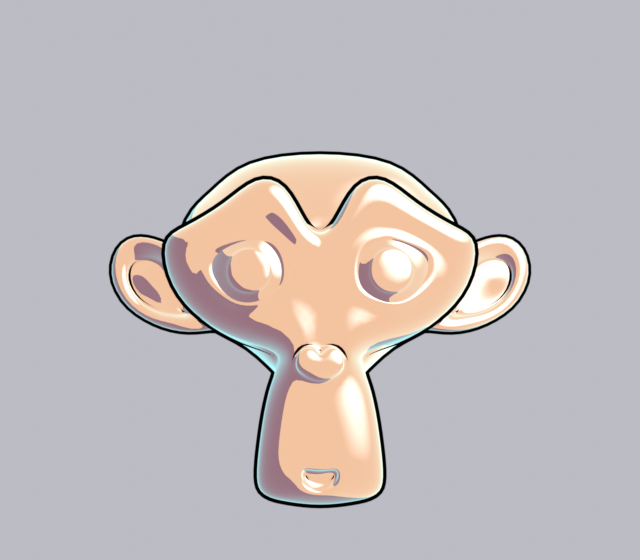
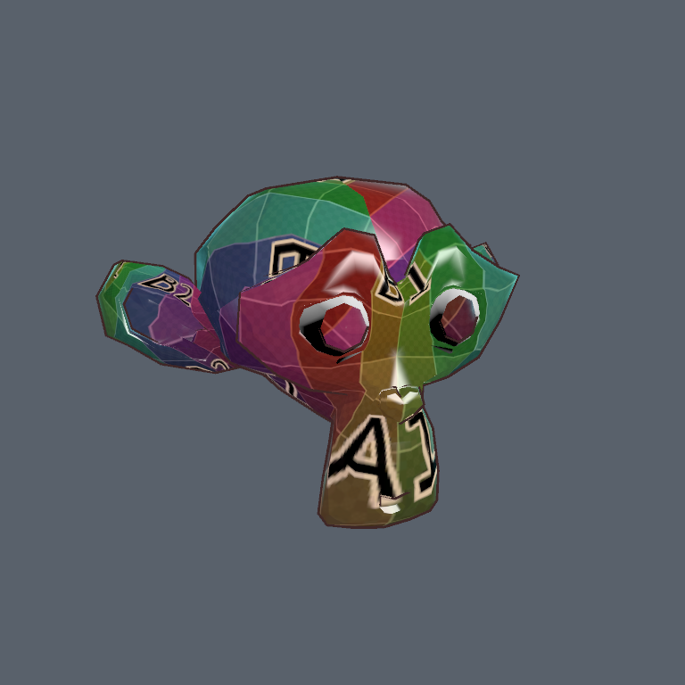

# Blender 連携

Blender で Natane Toon の見た目を確認し、調整した結果をパラメーターごと Unity に戻すための仕組みです。

- **Blender アドオン** (`Blender~/natane_toon_preview`): EEVEE でのプレビュー、Unity の `.mat` の読み込み、Unity 向けの書き出し
- **Unity 側のインポーター** (`Tools > Natane > Blender`): 書き出したファイルから Natane Toon のマテリアルを作り、モデルに割り当てる

アドオンの詳しい説明 (インストール、再現できる範囲とできない範囲) は `Blender~/natane_toon_preview/README.md` にあります。
`Blender~` は Unity が読み込まないフォルダーなので、パッケージのフォルダーをエクスプローラーで開いて取り出してください。

| Blender (EEVEE) でのプレビュー | 書き出したものを Unity に取り込んだ結果 |
| --- | --- |
|  |  |

(2 枚は別のテスト用マテリアルです。右は Blender で作ったマテリアルとテクスチャが Unity でそのまま付いた様子。)

## 流れ

```
Unity (.mat) ──読み込み──▶ Blender で確認・調整 ──書き出し──▶ Name.fbx
                                                              Name.natanetoon.json
                                                              textures/
                                                                  │
Unity ◀── Assets に入れると自動で反映 (マテリアル作成 + FBX へ割り当て) ┘
```

1. Blender で `ファイル > エクスポート > Unity (Natane Toon) (.fbx + .json)` を実行する。
2. できた `Name.fbx` / `Name.natanetoon.json` / `textures` を、**まとめて** Unity の `Assets` 内のフォルダーに入れる。
3. Unity が `.natanetoon.json` を見つけ、次のことを自動で行う。
   - 同じフォルダーの `Materials/` に、マテリアルごとの `.mat` を作る (すでにあれば上書き更新する)
   - シェーダー、キーワード、float、色、テクスチャ (タイリング・オフセット込み)、レンダーキューを設定する
   - `Name.fbx` のマテリアルを、作った `.mat` に差し替える (Materials タブの Remap と同じ)

Blender で直して書き出し直すと、同じ `.mat` が更新されます。シーンに置いたモデルの見た目もそのまま変わります。

### プロジェクトの外に書き出した場合

`Tools > Natane > Blender > Blender から取り込む Import from Blender` で `.natanetoon.json` を選ぶと、
コピー先のフォルダーを聞かれ、モデルとテクスチャごと `Assets` 内にコピーしてから取り込みます。

### 自動で反映したくない場合

`Tools > Natane > Blender > 書き出しファイルを自動で反映 Auto Apply Exports` のチェックを外します。
その場合は「Blender から取り込む」で手動で取り込みます。

## 取り込みの決まりごと

- **シェーダー**は、書き出しファイルのシェーダー GUID → シェーダー名の順で探します。
  どちらでも見つからなければ `Natane/Toon Shader` を使い、Console に警告を出します。
- **テクスチャ**は、元のテクスチャの GUID がプロジェクトにあればそれを使います
  (Unity の `.mat` を Blender に読み込んで調整した場合は、テクスチャが複製されません)。
  無ければ書き出しフォルダー内の相対パスから探します。
  名前に `Bump` / `NormalMap` を含むプロパティのテクスチャは、取り込み設定をノーマルマップにします。
- 見つからなかったテクスチャの欄は、今の設定を残します (消しません)。
- シェーダーに無いプロパティは飛ばし、件数を結果に表示します。
- **書き出しファイルに入っていないプロパティは変更しません。** 既存の `.mat` を更新する場合、Unity 側で足した設定は残ります。
- Natane Toon に変換していないマテリアルは JSON に入らないので、FBX のマテリアルのまま残ります。

## ファイル形式 (`*.natanetoon.json`)

```json
{
  "format": "natane-toon-material-set",
  "version": 1,
  "generator": "natane_toon_preview 1.0.0 / Blender 4.2",
  "model": "Name.fbx",
  "materials": [
    {
      "name": "Body",
      "shader": "Natane/Toon Shader (Cutout)",
      "shaderGuid": "",
      "sourceMaterialGuid": "",
      "renderQueue": -1,
      "keywords": ["_OUTLINE", "_RIM_LIGHT"],
      "floats":   [{ "name": "_ShadowOffset", "value": 0.1 }],
      "colors":   [{ "name": "_Color", "r": 1, "g": 1, "b": 1, "a": 1 }],
      "textures": [{ "name": "_MainTex", "path": "textures/Body.png", "guid": "",
                     "scaleX": 1, "scaleY": 1, "offsetX": 0, "offsetY": 0 }]
    }
  ]
}
```

- 色は Unity の `.mat` に保存されるのと同じ値 (sRGB) です。
- `path` は JSON のあるフォルダーからの相対パスです。
- `model` が空文字のときは、マテリアルだけを作ります。

## 確認した範囲

- Blender 4.2 LTS / 5.0 で書き出したサンプルを Unity 2022.3 (Built-in RP) に取り込み、
  マテリアルの作成・更新、値とテクスチャの反映、FBX への割り当てを確認。
- アーマチュア付きのアバター全体を往復させる確認はしていません。
