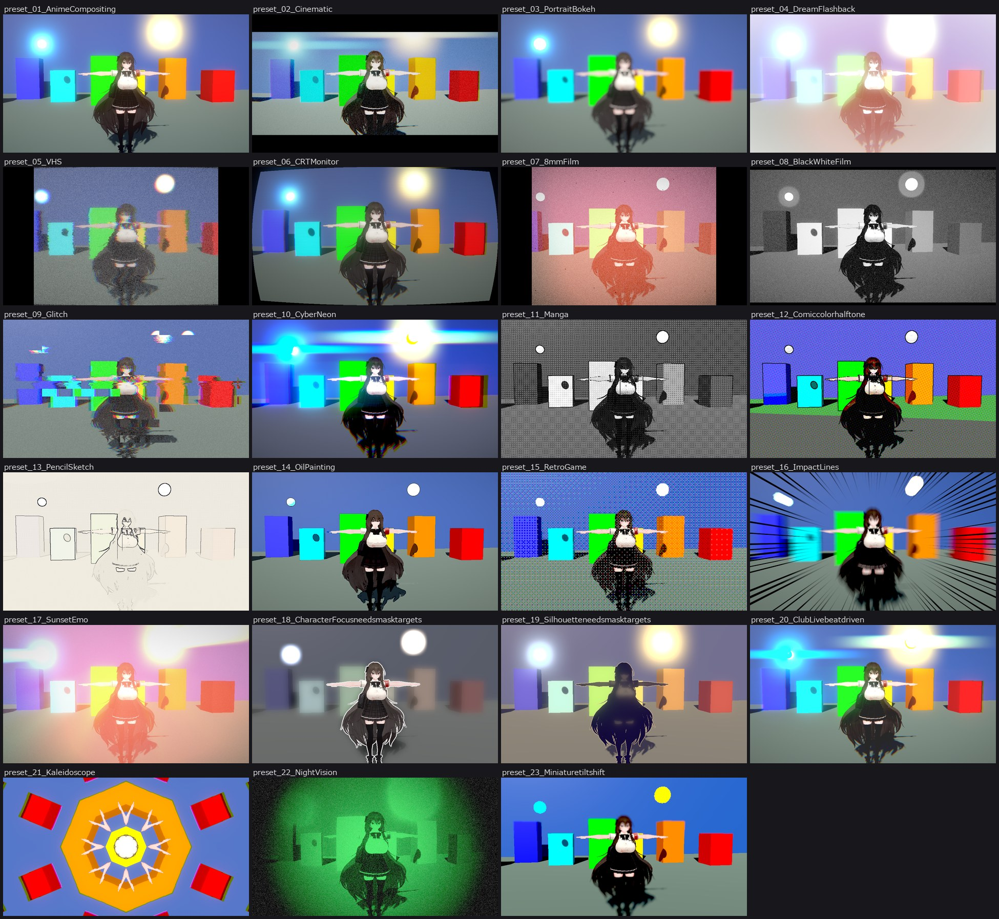

# Natane Post FX

MV やショート動画を Unity の中で作るための、カメラ用ポストエフェクトです。
Built-in RP と URP (Unity 6) のどちらでも同じコンポーネント・同じ設定で動きます。

コンポーネントはスクリプトなので、VRChat にアップロードするアバターやワールドではそのままは動きません。
ワールドでは、設定をシェーダーだけのマテリアルに書き出して使えます (下の「VRChat のワールドで使う」)。

## 使い方

1. カメラを選び、`Tools > Natane > エフェクト Effects > ポストエフェクトをカメラに追加 Add Post FX to Camera` を実行する
   (または `Add Component > Natane > Natane Post FX`)。
2. URP の場合は、インスペクター上部の「Renderer に追加」ボタンを押す
   (`Tools > Natane > URP > Post FX を Renderer に追加` でも同じ)。Renderer Feature が 1 つ追加されます。
3. インスペクターの「プリセット」から選ぶか、各項目を調整する。

すべての値は 0 (または既定値) で効果なしです。何も設定していない状態では、元の画像と 1 ビットも変わりません。
値はふつうの serialized フィールドなので、Animation / Timeline のアニメーショントラックでそのままキーを打てます。

### 対応環境

| | 対応 |
| --- | --- |
| Built-in RP | Unity 2019.4 以降 (`OnRenderImage`)。2022.3 で確認 |
| URP | Unity 6 (URP 17.1 以降、RenderGraph)。6000.3 / 6000.5 で確認 |
| URP 14〜16 (Unity 2022.3 / 2023) | **非対応** (Renderer Feature は読み込まれません) |
| VR (Single Pass Instanced) | **非対応** |
| シーンビュー | 表示されません。コンポーネントを付けたカメラのゲームビュー・録画にだけ掛かります |

### 「カスタムレンダーパイプライン」について

独自の SRP を新しく作ったわけではありません。既存のパイプラインに次の独自パスを差し込む形です。

- **キャラクターマスク パス**: 「対象」に指定したオブジェクトだけを別のバッファに描き、深度を記録します。
  背景だけをぼかす・暗くする、キャラクターに縁取りを付ける、シルエットにする、といった表現はこれを使います。
- **フルスクリーン パスの連鎖**: 必要なパスだけを毎フレーム組み立てます (使っていない効果のパスは実行されません)。
  Built-in RP では `OnRenderImage`、URP では RenderGraph のパスとして実行されます。シェーダーは共通です。

## 効果の一覧

処理の順番は上から下です。

### レンズ・画面の変形 (Lens)
レンズ歪曲 (樽 / 糸巻き)、色収差、RGB ずらし、放射ブラー (ズームブラー)、方向ブラー、ズーム、回転、位置ずらし、
画面揺れ、ミラー (左右 / 上下 / 4 分割)、万華鏡、タイル、波ゆがみ、陽炎、波紋・衝撃波、モザイク、ブラウン管の湾曲。

### グリッチ (Glitch)
ブロックずれ、走査線ずれ、縦ジャンプ、色ずれノイズ、VHS のうねり。

### 画風 (Style)
油彩 (桑原フィルター)、ポスタライズ、シャープ、エンボス、輪郭線 (色と深度から検出)、線画化、
網点 (モノクロ / カラー)、クロスハッチ、レトロ減色 (ディザ付き)。

### 光 (Glow)
ブルーム、アナモルフィックの光条、光芒 (ゴッドレイ。ライトに追従させられます)、ディフュージョン (ソフトフィルター)。

### ピント (Focus)
被写界深度 (対象の Transform に追従可)、チルトシフト、画面全体のぼかし。

### キャラクターマスク (Mask)
背景の彩度を落とす / 暗くする / ぼかす、キャラクターの縁取り (グロー可)、シルエット塗り。

### フォグ (Fog)
深度による距離フォグ。

### 色 (Color)
露出、コントラスト、彩度、自然な彩度、色相、色温度、色かぶり、トーンマップ (ACES / Reinhard / Neutral)、
リフト・ガンマ・ゲイン、暗部 / 明部の色づけ、LUT (横長ストリップ)、モノクロ、セピア、ネガ反転、ソラリゼーション、
2 値化、グラデーションマップ、暗視スコープ、サーモグラフィ。

### 重ねる (Overlay)
色かけ、グラデーションかけ、光漏れ、テクスチャ重ね (フレア・紙・ほこり素材)、フラッシュ、フェード、ビネット、
集中線、レターボックス。

### レトロ (Retro)
走査線、RGB マスク、フィルム粒子、縦傷、ちらつき、ほこり、砂嵐。

### 時間 (Time)
残像、光の尾、コマ落ち。

### 拍 (Beat)
BPM を入れると、拍に合わせてズーム・フラッシュ・色収差・ブルーム・画面揺れが脈打ちます。

## プリセット

アニメ撮影風、シネマティック、ポートレートのボケ、ドリーム、VHS、ブラウン管、8mm フィルム、モノクロ、グリッチ、
サイバーネオン、マンガ、アメコミ、鉛筆スケッチ、油彩、レトロゲーム、インパクト (集中線)、夕焼けエモ、
キャラクター強調、シルエット、クラブ / ライブ、万華鏡、暗視スコープ、ミニチュア。

プリセットは値を入れ替えるだけです (Undo できます)。マスクの「対象」やライトなどの参照は消しません。

画像のアバターは「ロコナ (Rokona)」です (確認用のスクリーンショットのみ。アバターのデータは同梱していません)。

## 録画するとき

`useCustomTime` をオンにして `customTime` を Timeline から動かすと、ノイズや揺れなどの動きが
実時間ではなくその値に従います。Unity Recorder で固定フレームレート録画をするときに、毎回同じ結果になります。

## VRChat のワールドで使う

コンポーネント (スクリプト) は VRChat では動きませんが、同じ効果をシェーダーだけで掛ける「ワールド用」を作れます。
画面を GrabPass で取り込み、カメラの前に置いたメッシュで全画面に描き直す方式です (Built-in RP 専用)。

1. Unity 上でカメラに Natane Post FX を付け、見た目を作る。
2. そのカメラを選んで `Tools > Natane > エフェクト Effects > ワールド用ポストエフェクトを作成 Create World Post FX` を実行する。
   マテリアルと専用メッシュが作られ、シーンにオブジェクトが置かれます。使う効果に応じて次の 3 つから自動で選ばれます。

| シェーダー | 画面コピーの回数 | 使える効果 |
| --- | --- | --- |
| `Natane/PostFX World (Color)` | 1 | フォグ・色・重ね・レトロ |
| `Natane/PostFX World (Lens + Color)` | 2 | 上に加えてレンズ変形・グリッチ |
| `Natane/PostFX World` | 3 | 上に加えて画風 (輪郭線・油彩・網点など) |

3. Animator や Udon からマテリアルのプロパティを動かす。

| プロパティ | 内容 |
| --- | --- |
| `_NPFX_Weight` | 全体の効き (0 で元の画面)。フェードイン・アウトはこれを動かす |
| `_NPFX_Range` / `_NPFX_RangeFade` | オブジェクトからこの距離 (m) の中にいる人にだけ掛ける。0 で無制限 |
| `_NPFX_ShowInMirror` | ミラーの中にも掛ける (既定はオフ) |
| `_NPFX_ShowInCamera` | VRChat のカメラ・スクリーンショットにも掛ける (既定はオン) |
| `_NPFX_UseDepth` | フォグと深度の輪郭線に必要。ワールドに影を落とす Directional Light が要ります |

注意点:

- **使えない効果**: ブルーム・光条・光芒・ディフュージョン、被写界深度・チルトシフト、全画面ブラー、キャラクターマスク、
  残像・コマ落ち。複数の解像度の中間バッファや前フレームが必要で、シェーダーだけでは作れないためです。
  作成時に、設定されているのに使えない効果があれば一覧で知らせます。
- **使う効果は作成時に決まります**。作成した時点で 0 (既定値) だった効果のコードはマテリアルから外れるので、
  あとから Animator で値を上げても出ません。動かしたい効果は、少しでも値を入れた状態で作成してください。
- `_NPFX_Weight` が 0 でも画面コピー (GrabPass) は行われます。使わない間はオブジェクトごと無効にしてください。
- 画面全体が揺れる・歪む・点滅する効果は VR で酔いやすく、光に敏感な人には危険なこともあります。
  範囲を絞る、弱めから始める、入口に注意書きを置くなどの配慮をしてください。
- 描画順は Overlay+500 です。これより後に描かれるものには掛かりません。VR (ステレオ) の実機表示は未確認です。

## 負荷

RenderDoc でフレームをキャプチャし、各ドローの GPU 時間 (同じキャプチャを 7 回再生した中央値) とピクセルシェーダーの命令数を
調べたうえで調整しています。数値は 3840x2160・RTX 5090・D3D11・Built-in RP でのもので、ほかの GPU では絶対値が変わります。

- 使っていない効果のコードは **シェーダーキーワードで丸ごと外れます**。以前は `if (強さ > 0)` で囲んでいましたが、
  コンパイラがこれを分岐ではなく「両方計算して選ぶ」形に展開しており、何も設定していなくても最終合成だけで
  791 命令・テクスチャ 17 回を毎ピクセル実行していました。いまは何も使わなければ 7 命令・1 回です。
- 何も効いていないときは、パス自体を実行しません。
- 被写界深度は、ぼけ量を半解像度に前計算してから集めるようにしました (1.20 ms → 0.18 ms)。
- 油彩 (Kuwahara) はバイリニア補間を使って取得回数を 1/4 にしました (半径 5 で 0.86 ms → 0.27 ms)。
- Built-in RP では最後のコピー 1 回を省いています。

| 設定 | 調整前 | 調整後 |
| --- | --- | --- |
| 何も設定していない | 0.23 ms | 0.08 ms |
| 色収差のみ | 0.33 ms | 0.11 ms |
| 輪郭線のみ | 0.37 ms | 0.14 ms |
| 被写界深度 | 1.20 ms | 0.18 ms |
| プリセット「VHS」 | 0.36 ms | 0.32 ms |
| プリセット「ポートレート (ぼけ)」 | 1.23 ms | 0.33 ms |
| 放射ブラー + 色収差 | 1.09 ms | 0.95 ms |

残っている重いものは、放射ブラーと色収差の併用 (サンプル数 × 3 色)、キャラクターマスク (対象をもう一度描く)、
色・重ね・レトロをすべて使うプリセットの最終合成 (0.15〜0.2 ms) です。
キーワードの組み合わせはビルド時にレンズ 16・画風 8・最終合成 64 通りになります。

## 入っていないもの

- オブジェクト単位のモーションブラー (速度バッファを使うもの)。方向ブラー・放射ブラー・残像で代用します
- SSAO、SSR、TAA などの画質向上系
- ASCII アート
- VR、URP 14〜16、シーンビュー (上の表のとおり)

URP の標準ポストプロセス (Volume) とは併用できます。Renderer Feature の「Injection Point」で、
標準ポストプロセスの前か後かを選べます (既定は後)。

## 確認した範囲

- Built-in RP (2022.3.33f1) と URP (6000.3.11f1 / 6000.5.7f1) で、各効果とプリセットを 1 つずつ描画して目視。
  効果なしの状態は元画像との差が 0。
- 軽量化の前後で、67 枚の描画結果を Built-in RP / URP 17.3 / URP 17.5 それぞれで比較。意図して変えた被写界深度・チルトシフト・
  油彩以外は差が 1/255 以内。URP 14 (2022.3) ではコンパイルが通ることだけ確認 (Post FX 自体は非対応)。
- ワールド用は Built-in RP (2022.3) で、コンポーネント版と同じ絵になることを 16 通りの設定で比較。VRChat の実機・VR では未確認です。
- 実機の VR、URP の Deferred、複数カメラのスタック、HDR 出力は未確認です。
