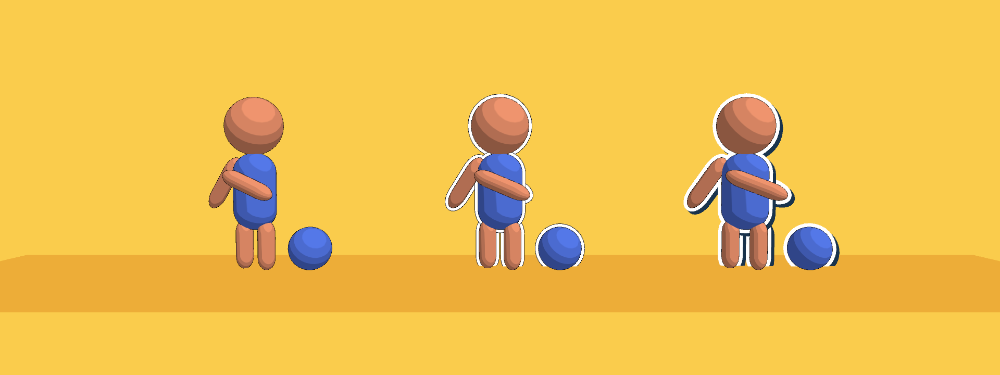

# Sticker バリアント (Natane/Toon Shader (Sticker))

シルエットの外側に均一な幅のフチを描いて、シール (ダイカットステッカー) のように見せるバリアントです。
ポストプロセスは使いません。フチはジオメトリなので MSAA がそのまま効きます。

Built-in RP 専用です (URP の SubShader はまだありません)。

## 使い方

1. マテリアルのシェーダーを `Natane/Toon Shader (Sticker)` にする
2. インスペクターの「ステッカー」セクションで幅と色を決める

| 設定 | 内容 |
|---|---|
| フチの色 / 幅 | 白フチ本体。幅は 1m 先での cm |
| 画面上の太さを一定に | 0 = 実寸、1 = 離れても同じ太さ |
| 明るさをライトに合わせる | 暗いワールドでフチだけ光るのを防ぐ |
| 台紙 | フチのさらに外側に敷く面。はみ出しを付けると外枠の線、ずらすと落ち影になる |
| 奥へ逃がす距離 | フチを置く面を、オブジェクト原点からどれだけ奥にするか。体の内側にフチが出るなら上げ、すぐ後ろの壁に埋まるなら下げる |
| ステンシルのビット | 他のステンシル演出とぶつかるときだけ変える |

## しくみ

Cutout バリアントに 2 パス足しています。

- 本体とアウトラインは、描いた画素のステンシルに印を付ける
- `STICKER` パス: メッシュを画面上の法線方向へ一定幅だけ押し出し、印の無い画素にだけ描く
- `STICKER_BACK` パス: 同じ形をさらに太く (またはずらして) 描く。台紙をオフにすると頂点を縮退させて何も描かない

押し出しは画面上の向きだけを使うので、見る角度によらず幅が揃います。
フチは「オブジェクト原点の奥行き + オフセット」の面まで視線に沿って下げてあります。
手前に出した腕のフチも胴体の後ろに回るので、別マテリアルの部位が後から描かれてもフチの上に本体が乗ります。

## 制限

- **角ばったメッシュ**はフチが割れたり角が欠けたりします。アウトラインの「スムース法線」か「コーナー補正」を使ってください
- **アルファで抜いた部分**は、抜いた形ではなくポリゴンの形でフチが付きます
- 1 体の中でこのバリアントと他のシェーダーを混ぜると、他のシェーダーの部位に重なる所にフチが出ることがあります
- 汎用のステンシル設定 (`_StencilRef` ほか) はこのバリアントでは使われません
- スミア / 顔直交投影など頂点を動かす機能には追従しません
- フチの奥行きはオブジェクト原点 (スキンメッシュはルートボーン) が基準です。原点がメッシュから大きく離れていると、フチが壁に埋まったり体の内側に出たりします
- バッチングは無効になります (`DisableBatching`)。GPU インスタンシングは使えます
- 描画パスが 2 つ増えます (ドローコール +2)
- VR とミラーでの見え方は実機未確認です
